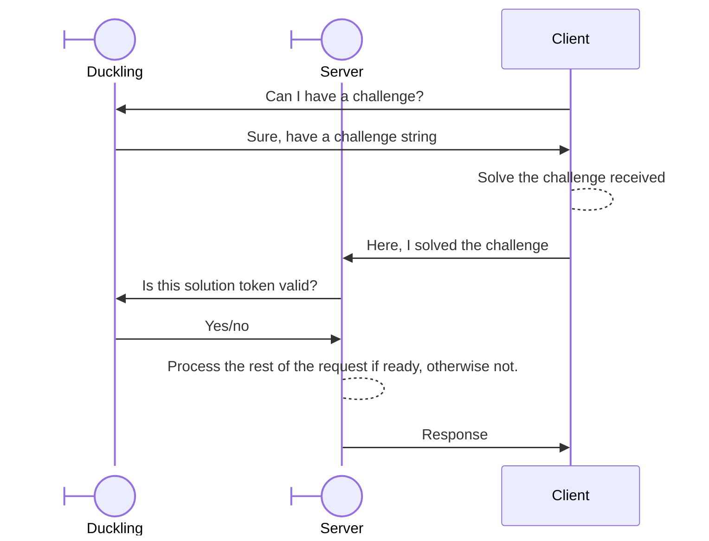

{/* Code blocks with no language have a bug that cause blank lines to have height 0. To work */}
{/* around this issue, we use blank braille characters (⠀) to force the line to display. */}

This guide will guide you through writing your own SDK for Duckity in any language. We'll use
examples for JavaScript and Python, taken from the official SDKs, so you can use as reference to
make one in any language of your choice.

This guide intentionally explains everything in simple words and with multiple examples. You'll find
it easy to follow this guide as long as you're comfortable in the language you're using.

The flow is simple:



## Getting a Challenge [step]

Duckity serves challenges through the duckling API. It's separate from the management API running on
a specialized backend. The hosted endpoint of such version is at `https://api.duckity.com/d1`.
Subsequent versions of this API will be named `d2`, `d3`, and so on.

To get a challenge, you need to be able to make HTTP requests and a protection profile ID. Requests
to get challenges look like follows:

```http
POST /d1/challenges/{protection_profile_id}/issue HTTP/1.1
Host: api.duckity.com
Accept: application/json
X-Duckity-CSRF: 1
```

The `X-Duckity-CSRF` header is required to enforce CORS preflight in web browsers and prevent CSRF.
Requests will be rejected with a `400 Bad Request` error if it's not set. Any value is valid for it.

The response will look like this:

```http
HTTP/1.1 200 OK
Content-Type: application/json
Access-Control-Allow-Origin: https://example.com
Access-Control-Allow-Methods: POST
Access-Control-Allow-Headers: X-Duckity-CSRF
X-RateLimit-Next-In: 1000
X-RateLimit-Resets-In: 1000
X-RateLimit-Remaining: 0

{
    "challenge": "<challenge-string>"
}
```

The headers returned are those that follow:

| Name                            | Description                                                                                                                            | Value Type         | Present When                                                                                           |
| ------------------------------- | -------------------------------------------------------------------------------------------------------------------------------------- | ------------------ | ------------------------------------------------------------------------------------------------------ |
| `Access-Control-Allow-Origin`   | The CORS origin, set to the value of the request's `Origin` header if present and valid.                                               | HTTP URL           | `Origin` is present in the request and matches one of the configured CORS origins for the application. |
| `Access-Control-Allow-Methods`  | The allowed methods for the endpoint. Only `POST` is listed, `OPTIONS` is implicit.                                                    | HTTP method list   | `Origin` is present in the request and matches one of the configured CORS origins for the application. |
| `X-RateLimit-Next-In`           | The amount of time to wait until a new request is added to the client's available quota.                                               | Milliseconds       | Always                                                                                                 |
| `X-RateLimit-Resets-In`         | The amount of time to wait for the requests quota to be fully reset.                                                                   | Milliseconds       | Always                                                                                                 |
| `X-RateLimit-Remaining`         | The amount of requests remaining in the client's current quota after this request.                                                     | Amount of requests | Always                                                                                                 |
| `X-RateLimit-Penalty-Resets-In` | The amount of time to wait for the penalty to be lifted, if any. This does not equal the amount of time to wait to make a new request. | Milliseconds       | The client is currently penalized.                                                                     |

When the client has made too many requests, the response will instead be an error:

```http
HTTP/1.1 429 Too Many Requests
Content-Type: application/json
X-RateLimit-Next-In: 1000
X-RateLimit-Resets-In: 1000
X-RateLimit-Remaining: 0
X-RateLimit-Penalty-Resets-In: 500

{
    "title": "Too Many Requests",
    "message": "You've made too many requests. Try again later."
}
```

Other errors, like an invalid protection profile, will result in a response of similar body
structure and with the corresponding status code.

## Decoding the Challenge [step]

Challenge strings have two sections separated by a dot. The first section is the challenge's data,
the second section is a signature to prevent tampering.

```
<challenge-data>.<challenge-signature>
```

Both sections are URL-safe Base64 strings with no padding. To read the challenge data, decode the
Base64 string and parse the JSON inside it. The decoded JSON will have the following structure:

```ts lineNumbers
type Challenge = {
    challenge_id: string; // The challenge's unique ID. 21-character NanoID using the default alphabet.
    ip: string; // The IP of the client the challenge was issued for. Only this client may submit a solution for validation.
    timestamp: number; // The milliseconds since UNIX epoch when the challenge was issued.
    protection_profile_id: string; // The ID of the protection profile this challenge was issued for. 21-character NanoID using the default alphabet.
    n: number[]; // An array of 32-bit unsigned digits, most significant digit first. The Wesolowski VDF N parameter.
    x: number[]; // An array of 32-bit unsigned digits, most significant digit first. The Wesolowski VDF X parameter.
    t: number; // The Wesolowski VDF T parameter.
};
```

These code pieces implement the decoding as a reference.

<Tabs items={["TypeScript", "Python"]} groupId="reference-language" persist>
    <Tab value="TypeScript" id="reference-language-ts">
        ```ts lineNumbers
        interface Challenge {
            // The challenge's unique ID.
            challenge_id: string;
            // The client's IP.
            ip: string;
            // The unix timestamp, in milliseconds, in which the challenge was issued.
            timestamp: number;
            // The ID of the protection profile this challenge was issued for.
            protection_profile_id: string;
            // The unsigned 32-bit digits of the N Wesolowski VDF parameter, most significant digit first.
            n: number[];
            // The unsigned 32-bit digits of the X Wesolowski VDF parameter, most significant digit first.
            x: number[];
            // The T Wesolowski VDF parameter.
            t: number;
        }

        /**
         * Extracts the challenge's data from the string.
         *
         * @param challenge The raw challenge string.
         * @returns The decoded challenge metadata.
         */
        export function decode(challenge: string): Challenge {
            if (challenge.match(/\./g) || []).length != 1) {
                throw Error("The challenge string contained too many or not enough sections.");
            }

            let [base64, _signature] = challenge.split(".", 2);
            let json = atob(base64.replaceAll("-", "+").replaceAll("_", "/") as string);
            let data: Challenge = JSON.parse(json as string);

            return data;
        }
        ```
    </Tab>
    <Tab value="Python" id="reference-language-py">
        ```py lineNumbers
        import base64, json

        from dataclasses import dataclass


        @dataclass
        class Challenge:
            id: str
            """The challenge's unique ID."""
            ip: str
            """The IP of the client this challenge was issued for."""
            timestamp: int
            """The UNIX timestamp in milliseconds at which this challenge was issued."""
            protection_profile_id: str
            """The ID of the protection profile this challenge was issued for."""
            n: list[int]
            """The unsigned 32-bit digits of the N Wesolowski VDF parameter, most significant digit first."""
            x: list[int]
            """The unsigned 32-bit digits of the X Wesolowski VDF parameter, most significant digit first."""
            t: int
            """The T Wesolowski VDF parameter."""


        def decode(challenge: str) -> Challenge:
            """Decodes a challenge string into its data.

            Arguments:
                challenge (str): The raw challenge string received from the duckling API.

            Returns:
                Challenge: The challenge's decoded data.

            Raises:
                ValueError: The challenge string was not valid.
            """

            if challenge.count(".") != 1:
                raise ValueError("The challenge string contained too many or not enough parts.")

            raw = challenge.split(".", 1)
            raw = raw[0]

            # Readds padding for decoding
            data = base64.urlsafe_b64decode(raw + "=" * (-len(raw) % 4))
            data = json.loads(data)

            try:
                return Challenge(
                    id=data["challenge_id"],
                    ip=data["ip"],
                    timestamp=data["timestamp"],
                    protection_profile_id=data["protection_profile_id"],
                    n=data["n"],
                    x=data["x"],
                    t=data["t"]
                )
            except KeyError as e:
                raise ValueError("The decoded challenge data was incomplete.") from e
        ```
    </Tab>

</Tabs>

## Solving the Challenge [step]

Solving challenges is relatively simple. It does, however, require to implement a few utility
functions by hand. Some libraries, like GMP, provide optimized versions of these functions. The
Python examples will show how to use GMP via the `gmpy2` library. The TypeScript examples will show
how to implement all of these functions by hand using JavaScript's `bigint`. In JavaScript, bigints
are written like normal `number`s with the `n` prefix, e.g. `1n`.

### Convert Digits to Integers [step]

The N and X challenge parameters are encoded as arrays of 32-bit unsigned digits. To be able to
operate on those numbers comfortably and efficiently, we first have to parse those digits.

The algoritm is simple. Start with `result = 0`, then for every digit in the array do
`result = (result << 32) | digit`. The following pseudocode displays it simply:

```
function get_integer_from_digits(digits: number[]) -> integer:
    result = 0
⠀
    for digit in digits:
        result = (result << 32) | digit
⠀
    return result
```

Easy. Then we can use that function on both X and N. The following examples show actual code
implementations of such function:

<Tabs items={["TypeScript", "Python"]} groupId="reference-language" persist>
    <Tab value="TypeScript" id="reference-language-ts">
        ```ts lineNumbers
        /**
         * Converts an array of u32 digits to a bigint.
         *
         * @param digits The digits of the bigint, MSF.
         * @returns The formed bigint.
         */
        function getBigintFromDigits(digits: number[]): bigint {
            let result = 0n;

            for (const digit of digits) {
                result = (result << 32n) | BigInt(digit);
            }

            return result;
        }
        ```
    </Tab>
    <Tab value="Python" id="reference-language-py">
        ```py lineNumbers
        # Your life will be brighter if you install `gmpy2-stubs` as a dev dependency, `gmpy2` does
        # not have typing stubs integrated, therefore no IDE autocompletion nor help.
        import gmpy2


        def get_mpz_from_digits(digits: list[int]) -> gmpy2.mpz:
            """Converts a list of u32 digits to a `gmpy2.mpz`.

            Arguments:
                digits (list[int]): The unsigned 32-bit digits.

            Returns:
                gmpy2.mpz: The resulting GMP number.
            """

            return gmpy2.mpz.from_bytes(b"".join(i.to_bytes(4) for i in digits))
        ```
    </Tab>

</Tabs>

### Perform the Computation [step]

Once we have our utility function to get numbers from digit arrays, we can perform the calculation
that burns CPU cycles. The result of this step will later be used to compute a proof; Should this
step be skipped, the proof will fail to validate.

In plain English, the computation is simple: starting with `Y = X`, repeat `Y = Y^2 % N` `T` amount
of times. In pseudocode:

```
y = x
loop t times:
    y = y**2 % n
```

`Y` will be our solution to the challenge.

This step is not skippable given that it's effectively `X^2^T % N`. Since `T` is large and so is X,
computing it in one operation is infeasible. For example, with `T = 1,000,000`, `2^T` has about
301,030 decimal digits (1,000,001 bits). By using the algorithm above in a loop, we can get the
result of the full computation without needing to build `2^T` nor `X^2^T` nor store it in memory.

This step is also not parallelizable. Each iteration needs to know the result of the previous one,
which leaves no advantage to GPUs. In code, this step would be

<Tabs items={["TypeScript", "Python"]} groupId="reference-language" persist>
    <Tab value="TypeScript" id="reference-language-ts">
        ```ts lineNumbers
        function solve(nDigits: number[], xDigits: number[], t: number): bigint {
            let n = getBigintFromDigits(nDigits);
            let x = getBigintFromDigits(xDigits);
            let y = x;

            for (let i = 0; i < t; i++) {
                y = y ** 2 % n;
            }

            return y;
        }
        ```
    </Tab>
    <Tab value="Python" id="reference-language-py">
        ```py lineNumbers
        import gmpy2


        def solve(n: list[int], x: list[int], t: int) -> gmpy2.mpz:
            n = get_mpz_from_digits(n)
            x = get_mpz_from_digits(x)
            y = x

            for _ in range(t):
                y = y**2 % n

            return y
        ```
    </Tab>

</Tabs>

<Callout title="Solving in Async Contexts">
    When solving a challenge in async contexts, this operation will block the runtime. To prevent
    it, run the operation in a worker thread/process and wait for it to finish asynchronously.

    In the JavaScript SDK, for example, solving the challenge is done in a web worker to prevent it
    from blocking the UI.

</Callout>

### Proving the Solution (Z) [step]

Now that we have our solution Y, let's make a proof we actually solved the problem. This will allow
the server to validate our solution without having to do all the iterations again. If our solution
happens to be invalid, the challenge will fail to validate to the server.

Making a proof is divided into two parts: getting parameter L and getting parameter PI (our proof).
PI depends on L, so lets get L first.

To get L, we'll create an intermediate parameter Z which is the result of SHA-256-hashing the
following parameters (in order):

1. `duckity` as ASCII bytes,
2. The challenge's `N` as 512 MSF bytes padded with 0s,
3. The challenge's `X` as 512 MSF bytes padded with 0s,
4. The challenge's `T` as 512 MSF bytes padded with 0s,
5. Our `Y` as 512 MSF bytes padded with 0s.

The result of hashing those parameters together will be 32 bytes, which will be our `Z` parameter.

For this, we'll need a new function to convert our bigints to digits (bytes). The algorithm is
simple, the inverse of what we used for our `get_bigint_from_digits()` to decode `N` and `X` in the
previous step. In pseudocode, it's

```
function get_digits_from_bigint(number: bigint, array_width: number, digit_byte_width: number) -> number[]:
    digits = [0] * array_width
⠀
    mask = 0;
    loop digit_byte_width times:
        mask = mask << 8
        mask = mask | 0b1111_1111
⠀
    for i in 0..array_width:  # [0; array_width), from 0 to array_width - 1 inclusive.
        digit = number & mask
        digits[array_width - 1 - i] = digit
        number = number >> (digit_byte_width * 8)
⠀
    return digits
```

In TypeScript and Python, that's

<Tabs items={["TypeScript", "Python"]} groupId="reference-language" persist>
    <Tab value="TypeScript" id="reference-language-ts">
        ```ts lineNumbers
        /**
         * Converts a bigint into a MSF digit array.
         * 
         * @param number The bigint number to convert.
         * @param arrayWidth The amount of digits to return, padded with 0s.
         * @param digitByteWidth The amount of bytes each digit will carry.
         * 
         * @returns The digits array.
         */
        function getDigitsFromBigint(number: bigint, arrayWidth: number, digitByteWidth: number): number[] {
            let digits: number[] = new Array(arrayWidth).fill(0);

            let mask = 0n;
            for (let i = digitByteWidth; i > 0; i--) {
                mask <<= 8n;
                mask |= 0b1111_1111n;
            }

            for (let i = arrayWidth - 1; i >= 0; i--) {
                let digit = Number(number & mask);
                digits[i] = digit;
                number = number >> (digitByteWidth * 8);
            }

            return digits;
        }
        ```
    </Tab>
    <Tab value="Python" id="reference-language-py">
        ```py lineNumbers
        import gmpy2


        def get_digits_from_mpz(number: gmpy2.mpz | int, array_width: int, digit_byte_width: int) -> list[int]:
            """Converts a MPZ integer to its MSF digits.

            Arguments:
                number (gmpy2.mpz | int): The number to convert to digits.
                array_width (int): The amount of digits to return, padded with 0s.
                digit_byte_width (int): The amount of bytes each digit will carry.

            Returns:
                list[int]: The digits.
            """

            digits = [0] * array_width

            mask = 0
            for i in range(digit_byte_width):
                mask <<= 8
                mask |= 0b1111_1111

            for i in range(array_width):
                digit = number & mask
                digits[array_width - 1 - i] = int(digit)
                number >>= digit_byte_width * 8

            return digits
        ```
    </Tab>

</Tabs>

Now that we have our bigint to digit converters, we can hash our values as described above.

```
hasher = SHA256()
hasher.update("duckity")
hasher.update(getDigitsFromBigint(n, 512, 1))
hasher.update(getDigitsFromBigint(x, 512, 1))
hasher.update(getDigitsFromBigint(t, 512, 1))
hasher.update(getDigitsFromBigint(y, 512, 1))
z = hasher.finish()
```

Easy. The following examples show how to do such thing in TypeScript and Python.

<Tabs items={["TypeScript", "Python"]} groupId="reference-language" persist>
    <Tab value="TypeScript" id="reference-language-ts">
        ```ts lineNumbers
        /**
         * Hashes the provided parameters to get Z.
         * 
         * @param n The challenge's N param.
         * @param x The challenge's X param.
         * @param t The challenge's T param.
         * @param y The computed Y param.
         * 
         * @returns Z as bytes.
         */
        async function getZ(n: bigint, x: bigint, t: bigint, y: bigint): number[] {
            let bytes = Array.from(new TextEncoder().encode("duckity"));
            bytes = bytes.concat(...getDigitsFromBigint(n, 512, 1));
            bytes = bytes.concat(...getDigitsFromBigint(x, 512, 1));
            bytes = bytes.concat(...getDigitsFromBigint(t, 512, 1));
            bytes = bytes.concat(...getDigitsFromBigint(y, 512, 1));

            let hash = await crypto.subtle.digest("SHA-256", new Uint8Array(bytes));
            let z = Array.from(new Uint8Array(hash));

            return z
        }
        ```
    </Tab>
    <Tab value="Python" id="reference-language-py">
        ```py lineNumbers
        import hashlib

        import gmpy2


        def get_z(n: gmpy2.mpz, x: gmpy2.mpz, t: int, y: gmpy2.mpz) -> list[int]:
            """Hashes the provided parameters to get Z.

            Arguments:
                n (gmpy2.mpz): The challenge's N parameter.
                x (gmpy2.mpz): The challenge's X parameter.
                t (int): The challenge's T parameter.
                y (gmpy2.mpz): The computed Y parameter.

            Returns:
                list[int]: Z as bytes.
            """

            hash = hashlib.sha256()
            hash.update(b"duckity")
            hash.update(bytes(get_digits_from_mpz(n, 512, 1)))
            hash.update(bytes(get_digits_from_mpz(x, 512, 1)))
            hash.update(bytes(get_digits_from_mpz(t, 512, 1)))
            hash.update(bytes(get_digits_from_mpz(y, 512, 1)))
            z = hash.digest()

            return z
        ```
    </Tab>

</Tabs>

### Proving the Solution (L) [step]

Getting `L` from `Z` involves interpreting our `Z` bytes as a big integer and getting the next prime
using the Miller-Rabin algorithm.

<Callout>
    This section will explain how to do both, yet it's likely that you will find an existing library
    for Miller-Rabin with an implementation you can use out of the box. If you choose to use such
    library instead, make sure you test on exactly 40 bases.
</Callout>

For this, we'll have to update our previous `get_bigint_from_digits()` to allow arbitrary digit
sizes. That's simple, instead of hardcoding the digit size we'll pass it as an argument to the
function. Our pseudocode will then look like

```
function get_integer_from_digits(digits: number[], digit_byte_width: number):
    result = 0
⠀
    for digit in digits:
        result = (result << (digit_byte_width * 8)) | digit
⠀
    return result
```

In TypeScript and Python, that's

<Tabs items={["TypeScript", "Python"]} groupId="reference-language" persist>
    <Tab value="TypeScript" id="reference-language-ts">
        ```ts lineNumbers
        /**
         * Converts an array of digits to a bigint.
         *
         * @param digits The digits of the bigint, MSF.
         * @param digitByteWidth The amount of bytes each digit carries.
         * @returns The formed bigint.
         */
        function getBigintFromDigits(digits: number[], digitByteWidth: number): bigint {
            let result = 0n;

            for (const digit of digits) {
                result = (result << (8n * BigInt(digitByteWidth))) | BigInt(digit);
            }

            return result;
        }
        ```
    </Tab>
    <Tab value="Python" id="reference-language-py">
        ```py lineNumbers
        import gmpy2


        def get_mpz_from_digits(digits: list[int], digit_byte_width: int) -> gmpy2.mpz:
            """Converts a list digits to a `gmpy2.mpz`.

            Arguments:
                digits (list[int]): The unsigned digits.
                digit_byte_width (int): The byte width each digit carries.

            Returns:
                gmpy2.mpz: The resulting GMP number.
            """

            return gmpy2.mpz.from_bytes(b"".join(i.to_bytes(digit_byte_width) for i in digits))
        ```
    </Tab>

</Tabs>

Then in our solving code, update the function calls to convert `N` and `X` to bigints with a byte
width set to 4 bytes.

Now let's interpret `Z` as a bigint. Since `Z` is currently the result of hashing our parameters
together, each byte will be a single-byte digit.

```
z = get_bigint_from_digits(z, 1)
```

To get `L`, we need to find the next prime to our `Z`. E.g. if `Z = 5`, `L = 7`. Note how 5 is
already a prime, yet we get the next one regardless.

Getting the next prime is simple. Starting with `Z + 1`, we call 40 Miller-Rabin tests to check
whether it's prime. Many libraries out there already implement Miller-Rabin tests so you don't have
to implement it yourself. In case you don't want to, or cannot, use such libraries, we'll explain
how to implement it manually here.

<Callout>
    The implementation described below is good enough for the values handled by the API. It is not
    meant to be general purpose beyond this SDK's implementation, and edge cases that do not apply
    to the calculations needed may be ignored. The Duckling server uses GMP's `next_prime()`
    function instead of a manual implementation.
</Callout>

Our implementation will be divided into 4 functions: `is_prime(number, amount_of_bases)`,
`is_prime_for_base(number, base)`, `get_next_prime(number, amount_of_bases)`, and
`mod_pow(base, exponent, modulus)`.

#### `mod_pow` [step]

This function will return the result of `(A^B) % C` without computing `A^B`. This way, we do not
have to store numbers too big in memory. The algorithm is simple:

```
function mod_pow(base: bigint, exponent: bigint, modulus: bigint) -> bigint:
    result = 1
⠀
    while exponent != 0:
        if (exponent & 1) == 1:
            result = result * base
            result = result % modulus
⠀
        base = base * base
        base = base % modulus
⠀
        exponent = exponent / 2
⠀
    return result
```

In TypeScript, this equals to

<Tabs items={["TypeScript"]} groupId="reference-language" persist>
    <Tab value="TypeScript" id="reference-language-ts">
        ```ts lineNumbers
        /**
         * Computes `(base ^ exponent) % modulus` efficiently, without storing `base ^ exponent` in
         * memory.
         * 
         * @param base The base of the modular exponentiation.
         * @param exponent The exponent of the modular exponentiation.
         * @param modulus The modulus of the modular exponentiation.
         * 
         * @returns The result of the modular exponentiation as a bigint.
         */
        function modPow(base: bigint, exponent: bigint, modulus: bigint): bigint {
            let result = 1n;

            while (exponent !== 0n) {
                // (something & 1n) is faster than (something % 2n)
                if ((exponent & 1n) === 1n) {
                    result *= base;
                    result %= modulus;
                }

                base **= 2n;
                base %= modulus;

                exponent /= 2n;
            }

            return result;
        }
        ```
    </Tab>

</Tabs>

#### `is_prime_for_base` [step]

This function will test a number using Miller-Rabin for the specified base. By later testing with
different bases in `is_prime()`, we increase the likelyhood of a number being prime. The test works
by exponentially reducing the chances of a number being a prime until it is extremely unlikely it's
not a prime, without checking whether the number is divisible by other numbers one by one. The
algorithm is simple:

```
function is_prime_for_base(number, base) -> boolean:
    number_minus_one = number - 1
    odd = number_minus_one
    base_times = 0
⠀
    while odd % 2 == 0:
        odd = odd / 2
        base_times = base_times + 1
⠀
    odd_power = mod_pow(base, odd, number)
⠀
    if odd_power == 1 or odd_power == number_minus_one:
        return true
⠀
    loop base_times - 1 times:
        odd_power = (odd_power * odd_power) % number
⠀
        if odd_power == number_minus_one:
            return true
⠀
    return false
```

In TypeScript, this can be implemented as

<Tabs items={["TypeScript"]} groupId="reference-language" persist>
    <Tab value="TypeScript" id="reference-language-ts">
        ```ts lineNumbers
        /**
         * Runs a single Miller-Rabin test on a number for a specific base.
         * 
         * This function assumes basic checks have been run on the number, like division by two and
         * by five.
         * 
         * @param number The number to check if is prime.
         * @param base The base to use to check if the number is prime.
         * 
         * @returns If the primality test yielded positive for the specified base.
         */
        function isPrimeForBase(number: bigint, base: bigint): boolean {
            let numberMinusOne = number - 1n;

            let odd = numberMinusOne;
            let baseTimes = 0;

            while (odd % 2n == 0n) {
                odd /= 2n;
                baseTimes += 1;
            }

            let oddPower = modPow(base, odd, number);

            if (oddPower == 1n || oddPower == numberMinusOne) {
                return true;
            }

            for (let i = 0n; i < baseTimes - 1n; i++) {
                oddPower = modPow(oddPower, 2, number);

                if (oddPower == numberMinusOne) {
                   return true;
                }
            }

            return false;
        }
        ```
    </Tab>

</Tabs>

#### `is_prime` [step]

Checking whether a number is likely a prime is simple. We'll discard numbers that pass basic tests
like division by 2 and by five, then we'll call `is_prime_for_base()` in loop starting in 2
increasing the loop by 1 after every iteration. All numbers between 2 and `number - 1` inclusive are
valid tests. In essence,

```
function is_prime(number, amount_of_tests) -> boolean:
    if number in [2, 3, 5, 7]:
        return true
⠀
    if number % 2 == 0 or number % 5 == 0:
        return false
⠀
    base = 2
⠀
    loop amount_of_tests times:
        if base >= number:
            break
⠀
        if not is_prime_for_base(number, base):  // Any test returning false means the number is certainly not a prime.
            return false
⠀
    return true
```

In TypeScript, that is

<Tabs items={["TypeScript"]} groupId="reference-language" persist>
    <Tab value="TypeScript" id="reference-language-ts">
        ```ts lineNumbers
        /**
         * Runs up to `tests` amount of tests to check whether a number is a prime.
         * 
         * @param number The number to check for primality.
         * @param tests The maximum amount of tests to run on the number. Setting this value to a
         * higher number means better precision at the cost of speed.
         * 
         * @returns `true` if the number is likely a prime, `false` if the number is not a prime.
         */
        function isPrime(number: bigint, tests: number): boolean {
            if ([2n, 3n, 5n, 7n].includes(number)) {
                return true;
            }

            // (something & 1n) is faster than (something % 2n)
            if ((number & 1n) === 0n) {
                return false;
            }

            if (number % 5n === 0n) {
                return false;
            }

            let base = 2n;

            for (let i = 0n; i < BigInt(tests) && base + i < number; i++) {
                let prime = isPrimeForBase(number, base + i);

                if (!prime) {
                   return false;
                }
            }

            return true;
        }
        ```
    </Tab>

</Tabs>

#### `get_next_prime` [step]

Last but not least, let's call our `is_prime` in a loop starting from `number + 1` until we find a
prime. We'll set the amount of tests to 40.

This algorithm is the most simple of all the `L`-getting flow:

```
loop indefinitely:
    number = number + 1
⠀
    if is_prime(number, 40):
        return number
```

Note that the `number = number + 1` goes _before_ the `is_prime()` call. We don't want the initial
`number` parameter to be returned if it's prime.

In TypeScript, that's

<Tabs items={["TypeScript"]} groupId="reference-language" persist>
    <Tab value="TypeScript" id="reference-language-ts">
        ```ts lineNumbers
        /**
         * Returns the first prime after a number.
         * 
         * Numbers are checked for primality using Miller-Rabin tests on 40 bases each number.
         * 
         * @param number The number to get the following prime for.
         * 
         * @returns The number's following prime.
         */
        function getNextPrime(number: bigint): bigint {
            while (true) {
                number += 1n;

                if (isPrime(number, 40)) {
                    return number;
                }
            }
        }
        ```
    </Tab>

</Tabs>

Now that we can get our next prime, it's finally time to get `L`.

```
l = get_next_prime(z)
```

That's it! In TypeScript and Python, that's

<Tabs items={["TypeScript", "Python"]} groupId="reference-language" persist>
    <Tab value="TypeScript" id="reference-language-ts">
        ```ts lineNumbers
        let l = getNextPrime(z);
        ```
    </Tab>
    <Tab value="Python" id="reference-language-py">
        ```py lineNumbers
        import gmpy2

        l = gmpy2.next_prime(z)
        ```
    </Tab>

</Tabs>

### Proving the Solution (PI) [step]

Once we have `L`, our last step towards getting everything we need to get a solution token is
getting `PI`. We want a parameter `Q` which comes from `2^T = Q * L + R`. Then for `PI`, we use
`PI = X^Q % N`. Not to compute `2^T` directly, we'll use a short algorithm to compute `PI`
progressively:

```
r = 1
pi = 1
⠀
loop t times:
    r = r * 2
⠀
    if r >= l:
        r = r - l
        pi = (pi * pi * x) % n
    else:
        pi = (pi * pi) % n
```

This way, we get our solution `PI` without filling up our memory with `2^T`. In Python and
TypeScript, this is

<Tabs items={["TypeScript", "Python"]} groupId="reference-language" persist>
    <Tab value="TypeScript" id="reference-language-ts">
        ```ts lineNumbers
        let r = 1n;
        let pi = 1n;

        for (let i = 0n; i < t; i++) {
            r = r * 2n;

            if (r >= l) {
                r = r - l;
                pi = (pi * pi * x) % n;
            } else {
                pi = (pi * pi) % n;
            }
        }
        ```
    </Tab>
    <Tab value="Python" id="reference-language-py">
        ```py lineNumbers
        import gmpy2

        r = gmpy2.mpz(1)
        pi = gmpy2.mpz(1)

        for i in range(t):
            r = r * 2

            if r >= l:
                r = r - l
                pi = (pi * pi * x) % n
            else:
                pi = (pi * pi) % n
        ```
    </Tab>

</Tabs>

Once that's done, we'll have our final `PI` value.

## Encoding the Solution [step]

Once we have our `Y` and `PI` values, it's time to encode them into a solution token. As stated at
the beginning of this guide, challenge tokens are encoded as

```
<challenge-data>.<challenge-signature>
```

We'll now encode our solution into a third segment to have a token that looks like follows:

```
<challenge-data>.<challenge-signature>.<solution-data>
```

Encoding the solution data segment is the inverse of decodind the challenge data segment. We'll
convert our `PI` and `Y` values to MSF u32 digit arrays of 128 digits using our
`get_digits_from_bigint()`, then encode that as JSON and the JSON as URL-safe Base64 with no
padding. The encoded JSON will have the following schema:

```ts
type Solution = {
    pi: number[];
    y: number[];
};
```

In TypeScript and Python, that's done as follows:

<Tabs items={["TypeScript", "Python"]} groupId="reference-language" persist>
    <Tab value="TypeScript" id="reference-language-ts">
        ```ts lineNumbers
        export function encode(original: string, y: bigint, pi: bigint): string {
            let solution = {
                y: getDigitsFromBigint(y, 128, 4),
                pi: getDigitsFromBigint(pi, 128, 4),
            };

            let solutionJson = JSON.stringify(solution);
            let solutionBase64 = btoa(solutionJson)
                .replaceAll("=", "")
                .replaceAll("+", "-")
                .replaceAll("/", "_");

            return `${original}.${solutionBase64}`;
        }
        ```
    </Tab>
    <Tab value="Python" id="reference-language-py">
        ```py lineNumbers
        import json

        import base64

        import gmpy2

        def encode(original: str, y: gmpy2.mpz, pi: gmpy2.mpz) -> str:
            y_digits = get_digits_from_mpz(y, 128, 4)
            pi_digits = get_digits_from_mpz(pi, 128, 4)

            solution = {"y": y_digits, "pi": pi_digits}
            solution = json.dumps(solution)
            solution = base64.urlsafe_b64encode(solution.encode("utf-8")).decode()
            solution = solution.replace("=", "")

            return f"{original}.{solution}"
        ```
    </Tab>

</Tabs>

That's it! Once you have your solution token encoded, you're ready to send it to the server for
validation.

## Validating the Solution [step]

Validating the solution is done server-side. Usually, the solution token is posted to the
application's backend server via a REST API and the server validates the challenge.

Sending the token from the client to the server is application-specific and not covered by SDKs.
Once the server has received the token, the first thing the server should do is to send a request to
the Duckling API to check whether the token is valid.

The request looks like follows:

```http
POST /d1/{protection_profile_id}/validate HTTP/1.1
Host: api.duckity.com
Authorization: Bearer <application-id>
Accept: application/json
Content-Type: application/json

{
    "solution": "<solution-token>",
    "ip": "123.123.123.123"
}
```

The `"solution"` key in the request's body will be the solution submitted by the client. The `"ip"`
will be the IP of the client that submitted the solution token.

<Callout type="warn">
    In case the server for any reason does not have a way of getting the client's IP, it can use the
    `"ip"` key in the challenge's encoded data. Note that this is NOT recommended as it will allow
    clients to submit solution tokens issued for different clients. The server must use the client's
    IP whenever possible.
</Callout>

The duckling API's response will look like follows:

```http
HTTP/1.1 200 OK
Content-Type: application/json

{
    "is_valid": true
}
```

That's it! Your SDK has its core implementation done, now it's time to write documentation for it,
error handling where due, and anything specific to the platform you have developed the SDK for.
